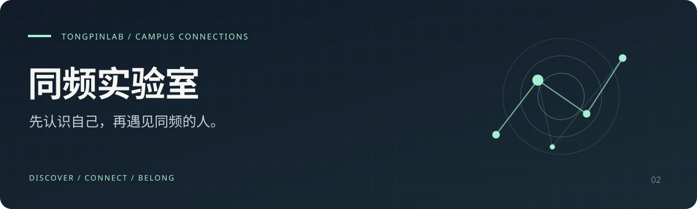

<p align="center"></p>

<h1 align="center">同频实验室 · TongPinLab</h1>
<p align="center"><b>面向高校学生的性格探索与校园社交产品。<br>先认识自己，再找到同频的人。</b></p>
<p align="center">Next.js 16 · TypeScript · SQLite / Turso · Docker</p>
<p align="center"><a href="#产品如何工作">产品流程</a> · <a href="#功能一览">功能</a> · <a href="#本地开发">本地开发</a> · <a href="#部署与文档">部署文档</a></p>

## 为什么做同频实验室

认识新朋友，难的常常是第一句话。性格探索帮助你了解自己，匹配问卷提供认识彼此的线索，广场与破冰话题让交流有一个自然的起点。

产品将人格测试、校园认证、双向匹配和私信串成一条完整路径，面向全国高校学生。

## 产品如何工作

**探索自己 → 完成参与准备 → 发现同频 → 开始交流**

1. **探索自己**：完成 32 题性格测试，进入统一社区，浏览官方话题及用户主动公开的动态。
2. **完成准备**：邮箱登录、校园认证、完善资料，并完成 20 题匹配问卷。
3. **发现同频**：在「今日同频」中发现真人推荐，或在广场参与话题、表达观点。
4. **开始交流**：真人双向选择后开启私信；按校园日常、兴趣交换等类别选择破冰话题。

## 功能一览

| 模块 | 体验与设计 |
| :--- | :--- |
| 性格探索 | 32 题测试，从认识自己的偏好与特点开始 |
| 校园认证 | 校园邮箱验证，以及学信网报告 / 学生证人工审核 |
| 双向匹配 | 基于问卷与资料发现同频，双方选择后才能真人私信 |
| 同频广场 | 官方话题、动态、点赞与评论，动态有不同可见范围 |
| 破冰与私信 | 分类话题、发送状态、日期分隔与草稿，帮助交流开始 |
| 虚拟伙伴 | 小同与小频提供明确标注的预设校园情境练习 |

## 参与与隐私

- 游客只能浏览官方话题与主动公开的动态；发帖、互动、匹配和私信需要完成参与准备。
- 校园邮箱认证仅表明邮箱归属已验证；学信网与学生证材料由所有者管理员人工审核。
- 认证材料加密保存，不在公开资料中展示；材料清理、认证有效期及账号注销范围见[工程说明](docs/ENGINEERING.md)。
- 虚拟伙伴与真人数据区分，提供预设情境，不支持开放式 AI 自由聊天。真人私信目前以文字为主，图片与表情留待后续版本。

## 本地开发

项目使用 **Next.js 16、React、TypeScript、Drizzle ORM**，本地默认 SQLite。建议使用 **Node.js 24**，依赖声明要求 ≥ 22.13.0。

```bash
git clone https://github.com/chen1904818062-ai/tongpinlab.git
cd tongpinlab
npm run install:ci
cp .env.production.example .env.local
```

本地开发可在 `.env.local` 中设置：

```dotenv
AUTH_ALLOW_DEMO_CODES=true
AUTH_COOKIE_SECURE=false
COS_ALLOW_LOCAL_STORAGE=true
```

```bash
npm run dev
```

首次访问数据库会自动执行 `drizzle/` 中尚未运行的迁移，默认数据库路径为 `data/tongpin.sqlite`。其他配置按环境变量示例与部署文档填写；上述演示配置仅用于本地开发。

检查与构建：

```bash
npm run lint
npm run build
```

隔离数据库回归和浏览器验收入口见[工程说明](docs/ENGINEERING.md#检查和构建)。

## 部署与文档

| 目的 | 文档 |
| :--- | :--- |
| 腾讯云：Docker、Nginx、HTTPS、COS 与备份 | [完整部署指南](deploy/README.md) |
| Render + Turso：备案期间免费内测 | [免费托管说明](deploy/FREE-HOSTING.md) |
| 认证、社区权限、注销、私信与验证脚本 | [工程说明](docs/ENGINEERING.md) |

腾讯云原部署默认使用本地 SQLite；Render 路径必须设置 `DATABASE_PROVIDER=turso`。生产环境保持 `AUTH_ALLOW_DEMO_CODES=false`、`AUTH_COOKIE_SECURE=true`、`COS_ALLOW_LOCAL_STORAGE=false`。

## 反馈与交流

欢迎通过 [Issues](https://github.com/chen1904818062-ai/tongpinlab/issues) 提出体验反馈与功能建议，请勿附上学生证、验证码或私人聊天内容。

由 **[陈宇杰 · kalsookie](https://github.com/chen1904818062-ai)** 独立构建 · 另一个项目：[拾言](https://github.com/chen1904818062-ai/shiyan)

<sub>A campus social product for personality discovery, mutual matching and easier conversations.</sub>
